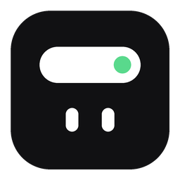

# Leo

**English** · [Bahasa Indonesia](README.id.md)



A living notch for the top edge of Windows. It shows your music with synced lyrics,
a focus timer, water reminders, to-dos, your class schedule, a file shelf and more —
then quietly gets out of the way.

Native Rust + Direct2D, no web engine: about 30–40 MB of RAM and no CPU while idle.

> **Leo** is a personal fork of [Amora](https://github.com/Merakkk/Amora) (MIT, © Helris). The notch core, lyrics and most modules come from Amora;
> Leo renames it and adds features on top (earbuds pop-up and more). See `LICENSE`.

## Install

Download `LeoSetup.exe` from [Releases](../../releases) and run it.

- Installs for your account only in `%LOCALAPPDATA%\Programs\Leo` — no admin rights.
- Adds a Start Menu shortcut, starts with Windows, and launches right away.
- Uninstall anytime from **Settings → Apps → Leo** (you choose whether to keep your data).

The installer is not code-signed yet, so Windows SmartScreen may warn you.
Click **More info → Run anyway**. Each release lists the SHA-256 of `LeoSetup.exe`
so you can verify the file.

Requires Windows 10 (1809+) or Windows 11, 64-bit.

## Features

Hover the notch to open it; scroll or click the page names to switch pages.

| Page | What it does |
|---|---|
| **Music** | Any player (Spotify, YouTube in the browser, …): cover art, play/pause/skip, seek. |
| | **Smart lyrics** from [LRCLIB](https://lrclib.net), synced line by line. YouTube-style titles (`Artist - Song (Official Video)`, VEVO / "- Topic" channels) are cleaned up so lyrics are found even for music videos. Re-search, per-song timing offset, click a line to jump. |
| | Sleep timer (15/30/60 min): fades the volume out, pauses, restores the volume. |
| **Focus** | Pomodoro timer; the countdown stays visible in the closed notch. |
| **Water** | Log what you drink, hourly chart, reminders during your active hours. |
| **To-do** | Type straight into the notch; end with `@14:30` for a reminder. |
| **Schedule** | Weekly classes: `Mon 08:00-09:40 Databases @R301` (English or Indonesian day names). Countdown before class, reminder 10 minutes ahead. |
| **Shelf** | Drop files on the notch, drag them out into a chat or folder (copied, never moved). New screenshots land here automatically. |
| **Clipboard** | Last 5 copied texts, in memory only. Off by default; skips password managers. |
| **Settings** | Every option, applied instantly. |

**Tidy tables for Google Docs / Word.** Copy a table from Claude, ChatGPT or Gemini — by
selecting it or with a "copy table" button — and just press Ctrl+V in Google Docs or Word:
Leo has already swapped it for a clean table with borders, a bold header row and column
widths that fit the content, in your document's own font. The plain text on
the clipboard is left untouched, so pasting into a text editor or a chat still gives the same
text. Spreadsheet tables (Excel, Google Sheets) and copies that include text outside the
table are left as they are.

In the closed notch:

- **OSD** for volume and screen brightness.
- **Notifications** for Caps Lock, keyboard language, charger / low battery, Wi-Fi / internet, audio output (e.g. headphones).
- **Privacy dots**: orange while an app uses the microphone, green for the camera.
- **Mascot**: when the PC has been idle, the clock steps aside and a pair of eyes appears; they doze off and say hi when you're back.
- **Leo additions** (on top of Amora):
  - **Settings window**: a separate, movable window (tray menu → *Pengaturan…*) instead of a tab inside the notch. Tabs: *Umum* and *Akun*.
  - **Notch size**: a *Ukuran notch* stepper (70–150 %) on top of the Windows DPI scale.
  - **Chat AI** (tray menu): opens Claude, Gemini or ChatGPT as an Edge/Chrome app window, with no API token. Each profile (`ai.profiles` in `settings.json`, default *Utama* and *Kedua*) has its own browser data, so you can switch accounts without logging out.
  - **Tasks & Makrab from Supabase**: sign in with Google (*Pengaturan → Akun*, more than one account, switch instantly). The notch shows deadline reminders (24 h, 3 h, 1 h, overdue) and a *Tugas* page with makrab progress. One-time setup: put the project's anon key in `settings.json` (`supabase.anon_key`) and add `http://127.0.0.1:53682/callback` to Supabase → Authentication → URL Configuration → Redirect URLs. Optional Gmail reminders from the server: see `supabase/README.md`.
- **Earbuds pop-up** (off by default; turn on in Settings → *Pop-up earbud*): open the case of your TWS earbuds near the PC and a pop-up appears in the notch. It listens for the Bluetooth LE advert with service `0xFD92` (e.g. KZ Vxs) and, while the earbuds are connected to this PC, shows the battery percentage that Windows reports (one number, not left/right/case). Name, device match and signal threshold are in the `earbuds` section of `settings.json`.
- **Minimal mode**: the closed notch becomes a thin line for laptops with a thick top bezel.
- **Gets out of the way**: when a tab or window sits behind the notch and your cursor heads there, the notch moves aside. Push the cursor against the very top edge to open the notch.

Right-click the notch or the tray icon for the menu.

## Privacy

No accounts, no analytics. Tasks, schedule, water log, shelf, settings and a local crash
log (`log.txt`, never sent anywhere) stay in `%LOCALAPPDATA%\Leo`. The only network traffic is to LRCLIB when lyrics are turned on
(off by default): song title, artist and duration. The keyboard hook only reacts to
Caps Lock and the language-switch keys; nothing you type is recorded.

## Building

Needs Rust (MSVC toolchain) and Visual Studio Build Tools with the Windows SDK.

```
cargo run --release
```

Build the installer (`dist\LeoSetup.exe` plus its SHA-256):

```
powershell -ExecutionPolicy Bypass -File tools\build-installer.ps1
```

`cargo test` runs the unit tests (title cleaning, LRC parsing, schedule and reminder parsing, …).
Developer flags are listed in [README.id.md](README.id.md#menjalankan-dari-kode).

## Inspiration

Inspired by [Nusa](https://rama2555.github.io/nusa/) for Windows and the macOS notch apps
such as [boring.notch](https://github.com/TheBoredTeam/boring.notch). Leo is an
independent implementation; no code was copied from those projects.

## License

[MIT](LICENSE)
